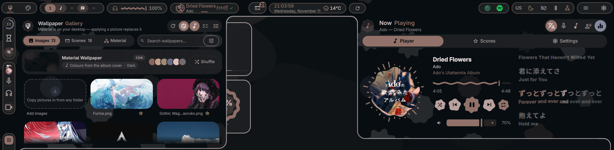
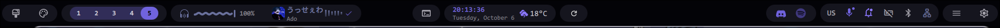
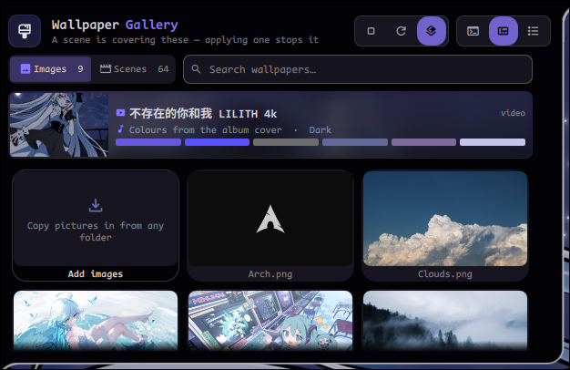
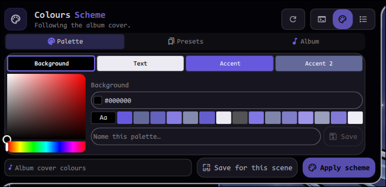
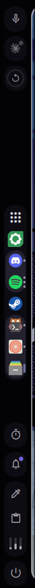
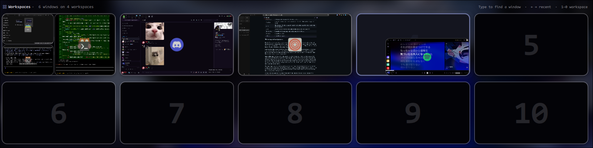
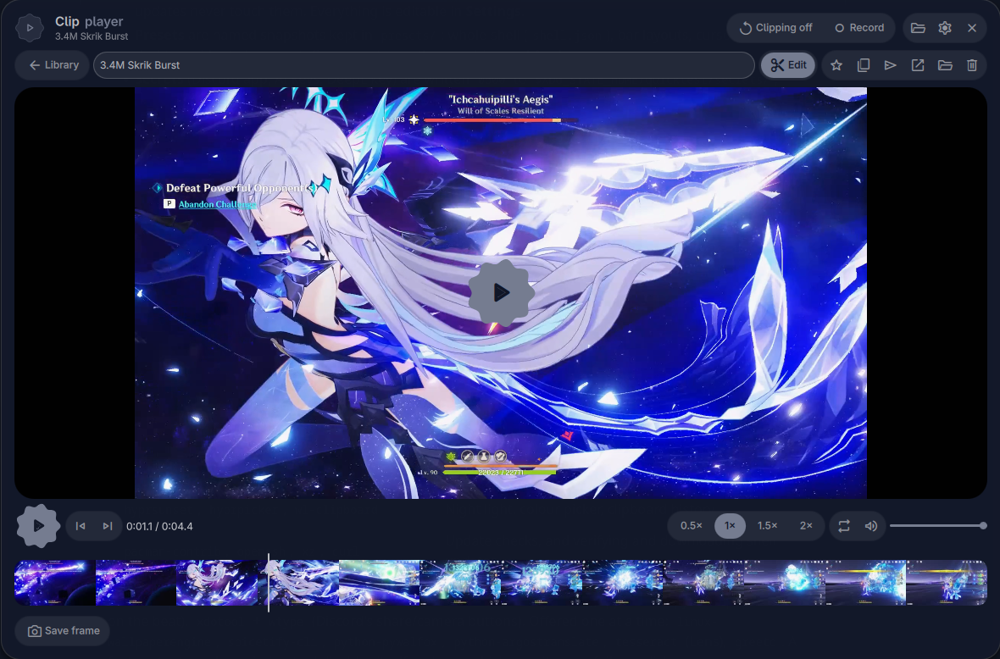
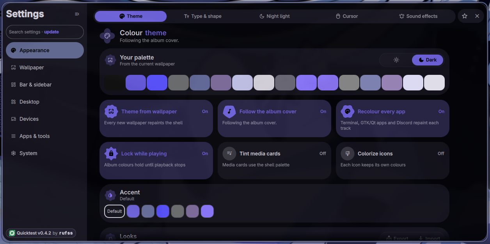

<div align="center">

# Quicktest

### A Quickshell desktop shell for Hyprland



`v0.4.1` &nbsp;|&nbsp; Arch Linux &nbsp;|&nbsp; Hyprland &nbsp;|&nbsp; QML / JS

</div>

Quicktest is a desktop shell built on [Quickshell](https://quickshell.outfoxxed.me/). On the
surface it's a bar and a sidebar. Underneath there's a launcher, a workspace overview,
a notification daemon, a lock screen, a clip recorder, a theming pipeline that repaints
your apps along with the shell, and a full settings app. Everything draws from one
wallpaper-derived palette and one set of design tokens.

**You need** Arch Linux, Hyprland 0.56 or newer (it uses the Lua config), and a GPU with a
Vulkan driver. Quickshell and everything else come from setup.

### Quick start

```sh
curl -fLO https://github.com/rufss14/Quickshell-Config/releases/latest/download/quicktest.tar.xz
tar -xJf quicktest.tar.xz -C ~/.config          # → ~/.config/quicktest
cd ~/.config/quicktest && ./setup.sh             # packages, then three yes/no questions
```

Log out and back in, and the shell starts with Hyprland. [Installation](#installation) has
the details, and the other ways to get it.

## What's new since v0.3

v0.3 rebuilt the codebase. v0.4 is what got built on top of it.

- **Panels that grow out of the bar.** Open a panel and it welds into the bar's frame as
  one shape. The optional blob plugin fuses the two with a metaball shader, and panels
  hug their content instead of sitting in fixed boxes.
- **A sidebar.** A second edge for the dock and a set of small modules: stats, clips,
  timer, colour picker, clipboard, notifications, screen time, Lens, a Discord call
  panel and a power menu. Every module can live on the bar or the sidebar, and you drag it between them.
- **A real dock.** Pinned and running apps, live window previews, a jump list on
  right-click, and SUPER+ALT+number to launch the nth app.
- **Clips.** A ShadowPlay-style replay buffer on `gpu-screen-recorder`. Save the last
  stretch with one key, record full screen or a region, then trim and export in a
  built-in editor.
- **A launcher that does more than launch.** Run commands, calculate, convert units,
  ask an AI or search the web, and install packages from the repos or the AUR.
- **A redesigned overview.** Alt+Tab and window search now work inside the workspace
  grid instead of in a separate switcher.
- **Theming that reaches further.** Colours can follow the album cover of what's
  playing, each workspace can have its own wallpaper and palette, a new colour washes
  across the screen as a wave, and open apps repaint live: terminal, GTK/Qt apps,
  Discord, Spotify, Dark Reader in the browser, even the mouse cursor.
- **Everyday tools.** OCR and translate anything on screen (Lens), a screenshot toast
  with an annotator, a magnifier, snap zones for floating windows, screen time, night
  light, an anti-flashbang filter, and optional sound effects.
- **It updates itself.** New releases show up in the update panel, signed, one click,
  no password. See [Updating](#updating).
- **First-run setup.** A welcome panel and **Settings → Setup** find what's missing
  and install it for you. The core install is smaller; Clips, Game Mode and the rest are
  feature packs you tick there.
- **Hardware settings.** Arrange your displays and set mode, scale, rotation and VRR, with
  15 seconds to undo a bad one. Mouse and touchpad settings. A battery saver that rests the
  ambient effects while you're unplugged.
- **Locking you can count on.** The screen locks before the machine sleeps (on by
  default), and SUPER+L falls back to hyprlock if the shell doesn't answer.

## Contents

1. [The bar](#the-bar)
2. [Panels](#panels)
3. [The sidebar and dock](#the-sidebar-and-dock)
4. [The launcher](#the-launcher)
5. [The overview](#the-overview)
6. [Theming and wallpapers](#theming-and-wallpapers)
7. [Clips](#clips)
8. [Everyday tools](#everyday-tools)
9. [Integrations](#integrations)
10. [Settings](#settings)
11. [Installation](#installation)
12. [Updating](#updating)
13. [Keybinds](#keybinds)
14. [Configuration](#configuration)
15. [Dependencies](#dependencies)
16. [Troubleshooting](#troubleshooting)
17. [Uninstalling](#uninstalling)
18. [Directory structure](#directory-structure)
19. [Architecture notes for contributors](#architecture-notes-for-contributors)

## The bar



Two independent choices shape it: **floating pills** or **square, edge-to-edge** corners,
and **unified** (each region one pill, with dividers) or **split** (one pill per group).
Thickness, radius, inset, spacing, opacity, font and icon scale are all in
**Settings → Bar**. The layout is drag and drop: drop a module onto another to group them,
into a gap to start a new group, or back into the pool to remove it. Save arrangements as
presets and switch between them.

| Module | What it does |
|--------|--------------|
| Workspaces | Live workspace dots; drop a window on one to move it there |
| Visualizer | Live spectrum and the current track; click for Now Playing with synced lyrics |
| Clock | Time and date, with the weather beside it |
| Volume · Microphone | Scroll to change, click for the mixer |
| Wi‑Fi · Bluetooth · Battery | Status at a glance, click for the panel |
| Wallpaper · Colour scheme | Open the gallery and the palette editor |
| Updates | Pending packages plus shell updates; click to install |
| Notifications | The notification panel; right-click for Do Not Disturb |
| Night light · Stay awake · Gamemode | One-click toggles |
| Keyboard layout | The active layout; click to cycle |
| System tray | Hides itself when empty |
| Overview · Settings · Reload | What they say |
| Bar shape · Bar mode | Flip the two layout choices above |

## Panels

Every panel opens from the bar and follows one recipe: a header with an icon, a two-word
title and an action tray, content that sizes the panel, and the shared sliders, fields and
buttons. Panels open beside each other and morph from one to the next.

<table>
<tr>
<td></td>
<td></td>
</tr>
<tr>
<td align="center"><sub>The wallpaper gallery: images and Wallpaper Engine scenes in one place</sub></td>
<td align="center"><sub>The colour scheme panel: edit any slot, save palettes, follow the album</sub></td>
</tr>
</table>

There are panels for Wi‑Fi, Bluetooth (pairing, battery levels, sending files), the audio
mixer and equalizer, updates, notifications, the clipboard, Now Playing with lyrics, and
more.

## The sidebar and dock



The edge the bar doesn't own. Place modules along it in three regions, the same way you
arrange the bar; it can auto-hide and dodge windows.

- **Dock**: pinned apps, then running ones. Click to focus (or cycle windows),
  middle-click to close, right-click for the app's jump list, drag to reorder.
  Hover for live window previews.
- **Small modules**: stats (CPU, GPU, memory, network), clips, timer, colour picker,
  clipboard, notifications, screen time, Lens, shell tools, Claude Code sessions, the
  Discord call panel, and power (lock, suspend, log out, reboot, shut down).

SUPER+D reveals it while it's hidden; SUPER+SHIFT+D hides or shows the whole sidebar.

<br clear="right">

## The launcher

SUPER+R. Type to search apps, ranked by how you actually launch them. Prefixes switch modes:

| Type | To |
|------|----|
| `firefox` | Find an app (Ctrl+P pins it to the dock) |
| `>` command | Run it in your terminal |
| `?` question | Ask an AI provider (bring your own key), or search the web |
| `12*8` | Calculate |
| `10 km to mi` | Convert units |
| `+` name | Install a package from the repos or the AUR, with live progress |

## The overview



SUPER+TAB. A dimmed overlay with every workspace as a live grid of window thumbnails.
Drag windows between workspaces, type to find a window, use the arrow keys for recent
windows, or press 1–0 to jump to a workspace. **Alt+Tab** works inside the same grid: the
picked window lifts out and everything else recedes. Volume, brightness and the power
controls sit around the grid.

## Theming and wallpapers

- **The palette.** Sixteen colours extracted from the wallpaper by pywal, in light or dark,
  applied live. Pin individual colours, save whole schemes, or pick one of the bundled
  ones: Blue Haven, Clouds Above, Crimson Moon, Light Novel Addict, Monochrome,
  NOexistenceN, RuLe and Stellar Constellation.
- **Follow the album cover.** While music plays, the shell can take its colours from the
  cover art, and optionally lock them until playback stops.
- **Recolour every app.** Each palette change also repaints kitty, GTK and Qt apps,
  Discord (Vencord/Vesktop), Spotify (Spicetify), Steam (Millennium), Zen/Firefox
  (Pywalfox), Dark Reader's page colours, the Hyprland borders and the mouse cursor. Open apps update in place.
  Each target is skipped when its app isn't installed.
- **The wave.** A new wallpaper or colour arrives as one front sweeping up the screen,
  instead of everything snapping at once.
- **Wallpapers.** Images from your library folder, or animated Steam Workshop scenes
  through `linux-wallpaperengine` (FPS cap, audio reactivity, parallax, pause on
  fullscreen). Shuffle on a timer, and give each workspace its own wallpaper and palette.
  Each monitor wears the colours of the workspace it's showing.

A master switch lets you change wallpapers without touching the palette, if you'd rather
hand-pick your colours.

## Clips



A replay buffer and recorder on `gpu-screen-recorder`. Both are off until you turn them on.

- **Clipping** keeps the last stretch of gameplay in memory. ALT+F10 saves it.
- **Recording**: ALT+F9 for the whole screen, ALT+SHIFT+F9 for a region.
- **The editor** trims with in/out points, then exports video or GIF, a fast lossless cut
  or a precise one, to a size target (10/25/50 MB) and resolution, with game audio and
  mic mixed, separate or muted. It can also save a single frame.
- **The library** lists every clip with favourites, rename, copy and open.

## Everyday tools

| Tool | |
|------|---|
| **Lens** | SUPER+O: select an area, copy its text (OCR). SUPER+SHIFT+O translates it in place |
| **Screenshots** | Your screenshot tool's notification becomes a toast with a preview: copy, annotate (pen, shapes, pixelate), send over Bluetooth, or move to the trash |
| **Magnifier** | SUPER+CTRL+scroll to zoom in steps, SUPER+CTRL+Z to toggle |
| **Snap zones** | SUPER-drag a floating window to an edge for half, a corner for a quarter, the top for full |
| **Screen time** | Daily and weekly time per app, counted only while you're actually there |
| **Night light** | Warm the screen, on a schedule or by hand (`hyprsunset` or `gammastep`) |
| **Anti-flashbang** | Dims a sudden full-white screen before it hits your eyes |
| **Game mode** | SUPER+G: CPU on performance, notifications paused, no screen blanking, and the desktop stops drawing what the game covers |
| **Sound effects** | Optional, synthesised UI sounds and keyboard clicks, per group and volume |
| **Notifications** | A built-in daemon (replaces dunst/swaync) with toasts, history and Do Not Disturb |
| **Lock screen** | The shell's own, locking before suspend (on by default) and optionally when idle, plus an optional greetd login screen with the same look |

## Integrations

- **Discord.** A call panel in the sidebar: who's talking, per-person volume and stereo
  pan, mute/deafen, your audio settings. Rich presence for Claude Code sessions and for
  Counter-Strike 2, which Discord can't detect on Linux by itself. Works with Vesktop,
  WebCord, Legcord, ArmCord, Dorion, Canary and PTB as well as the official client.
- **Spotify.** Word-by-word synced lyrics through a bundled Spicetify bridge, with
  NetEase and LRCLIB as fallbacks and optional translation.
- **Claude Code.** Recent sessions to resume, and your rate-limit usage at a glance.
- **Steam.** With Millennium installed, Steam repaints with the palette, live.

## Settings



A full settings app, searchable, in ten groups:

| Group | Pages |
|-------|-------|
| Appearance | Theme, type and shape, night light, cursor |
| Wallpaper | Images and Wallpaper Engine scenes |
| Bar & sidebar | Modules, style, behaviour, panels |
| Launcher | AI provider, terminal, web search, history |
| Sidebar | Layout, screen time, clips |
| Desktop | Widgets, widget style, lock screen |
| Devices | Sound, sound effects, displays, Wi‑Fi, traffic, Bluetooth, keyboard and mouse, language, battery |
| Window manager | Keybinds and compositor tuning, written straight to your Hyprland config, with backups |
| Integrations | Lyrics, Discord, rich presence |
| System | Updates, setup, shell presets, storage, about |

## Installation

Arch Linux with Hyprland. You need a Vulkan driver; the setup script picks the right one
for your GPU.

**1. Get the shell.** For automatic updates, install from a release:

```sh
curl -fLO https://github.com/rufss14/Quickshell-Config/releases/latest/download/quicktest.tar.xz
tar -xJf quicktest.tar.xz -C ~/.config      # → ~/.config/quicktest
```

Every release also has a `quicktest.zip` of the same files, if you'd rather unzip it into
`~/.config/quicktest` by hand. The built-in updater works with either.

Or clone it (then you update with `git pull`, not the built-in updater):

```sh
git clone https://github.com/rufss14/Quickshell-Config.git ~/.config/quicktest
```

**2. Run setup.**

```sh
cd ~/.config/quicktest && ./setup.sh
```

It installs the packages, then asks one yes/no each about the blob plugin, the bundled
Hyprland config (your current one is backed up first) and the autostart line.
`./setup.sh --packages` does only the packages. Skipping anything is safe: the same steps
are in the welcome panel and **Settings → Setup** the first time the shell starts.

**3. Launch.** Log out and back in if you installed the autostart line, or start it by hand:

```sh
bash -c 'source scripts/shell-env.sh && exec qs -p "$PWD"'
```

If you kept your own Hyprland config, edit `~/.config/hypr/hardware.lua` for your
monitors when using the bundled one, or add the [keybinds](#keybinds) you want to yours.

<details>
<summary>Step by step instead of <code>setup.sh</code></summary>

```sh
scripts/install-dependencies.sh            # core + AUR packages, the font, the Vulkan driver, the Clips/Game Mode/blob packs
scripts/install-hypr-config.sh             # the bundled Hyprland config (--print to preview)
scripts/install-autostart.sh               # or just the autostart line for your own config
scripts/build-blobs-plugin.sh              # optional: the blob plugin
```

`install-dependencies.sh --official` / `--aur` / `--packs` print the package lists without installing;
`--pack ddc|beatsync|discordkeys` adds an optional feature pack.

</details>

## Updating

The shell checks for a new release every 6 hours (**Settings → Updates**), or whenever you
press the gear next to the password field in the update panel. When there's one, the gear
fills and the update pill counts it. Click it: no password, since the shell lives in your
own config folder. The shell restarts on the new version.

Every release is signed, and your install only accepts updates signed with the key it
already has. An update keeps your settings, saved presets and colour schemes, API keys,
and anything else you added. Shell files you edited by hand **are** replaced, so keep your
tweaks in a shell preset (**Settings → Shell preset**) rather than in the source.

Coming from v0.3 or older, or installed with `git clone`: install this version once by
hand. Older releases have no updater, and a git checkout updates with `git pull`.

## Keybinds

These are in the bundled Hyprland config. On your own config, any of them can be bound to
the same `qs ipc` call.

| Keys | Action |
|------|--------|
| SUPER+R | Launcher |
| SUPER+TAB | Overview |
| ALT+TAB / ALT+SHIFT+TAB | Switch windows (inside the overview grid) |
| SUPER+D · SUPER+SHIFT+D | Reveal the sidebar · hide/show it entirely |
| SUPER+T | Focus the dock |
| SUPER+ALT+1…9 | Launch or focus the nth dock app |
| SUPER+O · SUPER+SHIFT+O | Lens: copy text · translate |
| SUPER+G | Game mode |
| SUPER+CTRL+scroll · SUPER+CTRL+Z | Magnifier |
| ALT+F10 · ALT+SHIFT+F10 | Save a clip · toggle clipping |
| ALT+F9 · ALT+SHIFT+F9 | Record the screen · record a region |
| ALT+Q | Restart the shell |
| SUPER+L | Lock (falls back to hyprlock if the shell doesn't answer) |

```sh
qs ipc -c ~/.config/quicktest call launcher toggle
qs ipc -c ~/.config/quicktest call overview toggle
qs ipc -c ~/.config/quicktest show              # every target the shell exposes
```

## Configuration

- **Your settings** live in `$XDG_STATE_HOME/quickshell/by-shell/<id>/config.json`
  (Quickshell's state folder for this shell), outside the shell folder, so updates never
  touch them. Everything is editable from **Settings**.
- **Shell presets** are whole named snapshots of every setting, kept in
  `presets/shell.json`. Save one in **Settings → Shell preset**, carry it to another
  machine, Apply. Bar layouts (`presets/bar.json`), cursor looks (`presets/cursor.json`)
  and desktop widget placement (`presets/widgets.json`) are separate files.
- **Secrets** (the Discord app, AI keys, DeepL key) are written `0600` by their
  settings pages to `$XDG_STATE_HOME/quicktest/secrets/`, outside the shell folder, and
  never leave your machine. Create your own from those pages.
- **Wallpapers** are read from `~/wallpapers/walls` unless you choose another folder in
  **Settings → Wallpaper**.

## Dependencies

`./setup.sh` installs the core and the default feature packs. The main ones:

| Package | For |
|---------|-----|
| `quickshell`, `hyprland`, `qt6-*` | The shell, the compositor, the Qt runtime |
| `pipewire`, `wireplumber`, `networkmanager`, `bluez` | Audio, network, Bluetooth |
| `python-pywal16`, `python-pillow`, `imagemagick` | Palettes from wallpapers and album art, the cursor theme |
| `cava` | The audio visualizer |
| `pacman-contrib` | Update checks (Flatpak apps are updated too, if you have Flatpak) |
| `gpu-screen-recorder`, `ffmpeg`, `slurp` | Clips (feature pack, on by default) |
| `hyprsunset`, `hyprpicker`, `wl-clipboard` | Night light, colour picker, clipboard history |
| `gamemode`, `mangohud` | Game mode (feature pack, on by default) |
| `openssh`, `xz`, `curl` | Verifying and downloading shell updates |

**Optional feature packs**, unticked in **Settings → Setup**: `ddcutil` (external-monitor
brightness), `python-numpy` (wallpaper effects on the beat), `xdotool` + `wtype` (Discord's
share/camera buttons).

**Optional**, offered one at a time in **Settings → Setup**: `linux-wallpaperengine`
(animated wallpapers), `spicetify-cli` (Spotify lyrics and theming), `python-pywalfox`
(browser theming), `python-argostranslate` (offline lyrics translation), `tesseract` (Lens),
and `greetd` (the login screen). Every feature that needs one disables itself with a
reason when it's missing, instead of failing on click.

## Troubleshooting

- **Something is missing or greyed out.** Open **Settings → Setup** and press
  **Health check**: it lists what isn't installed or set up, and installs it. A control
  that needs a missing tool says which one.
- **The shell misbehaves.** ALT+Q restarts it. Its log:
  `qs log -p ~/.config/quicktest` (add `-f` to follow it).
- **A setting won't stick, or the bar looks wrong after an update.** Your settings are in
  the file under [Configuration](#configuration). Move it aside and restart to get the
  defaults back.

## Uninstalling

```sh
~/.config/quicktest/scripts/install-autostart.sh --uninstall   # remove the autostart line
rm -rf ~/.config/quicktest
```

If you installed the bundled Hyprland config, setup first copied your old one to
`~/.config/hypr.bak.<timestamp>`; move that back to `~/.config/hypr`. Your settings and secrets stay under
`$XDG_STATE_HOME` (usually `~/.local/state`) until you delete them.

## Directory structure

```
quicktest/
├── shell.qml              Entry point: every surface, per screen
├── config/                Design system (Colors, Tokens, Motion) and Config, the settings store
├── state/                 What's on screen right now (UiState, Morph, Intro), not persisted
├── services/              One singleton per system resource, with its logic in a testable .js
├── components/            Shared UI: buttons, sliders, fields, cards, meters, the dock strip
├── modules/
│   ├── bar/               The bar, the sidebar host, BarPanelDock (where panels open)
│   ├── panels/            Every panel: wallpaper, colours, mixer, updates, launcher, clips…
│   ├── overview/          The overview and its workspace grid
│   ├── desktop/           Screen frame, desktop widgets, snap overlay
│   ├── notifications/     Toasts, history, the screenshot toast
│   ├── lock/ · greet/     Lock screen and greetd login screen
│   ├── settings/          The settings app and its pages
│   └── …                  dock, osd, discord, lyrics, net, onboard
├── hypr/                  The bundled Hyprland config (Lua)
├── plugin/                The optional blob plugin (C++)
├── shaders/               Custom shaders (liquid glass, the wave)
├── spicetify/             The Spotify bridge extension
├── colorschemes/          Bundled colour schemes
├── presets/               Bar, cursor, widget and shell presets
├── release/               The key that verifies shell updates
├── docs/                  Per-feature notes: how each part works and why
├── assets/                Icons, fonts, logos, previews
└── scripts/               Helpers the services call, installers, and the test suites
```

## Architecture notes for contributors

A few rules the codebase holds itself to. Worth reading before a pull request, along with
the file in `docs/` for the area you're touching. [CONTRIBUTING.md](CONTRIBUTING.md) has the
practical side: how to check a change and how to add a setting, service, page or dependency.

**Colours only from `Colors`, everything else from `Tokens` and `Motion`.** No hardcoded hex,
spacing, radius or duration. A visual file reads its own screen's palette,
`Colors.of(QsWindow.window)`, because each monitor can wear a different one.

**One service per system resource.** A widget binds to the service. It never opens its
own subprocess or poller for data another part of the shell already has.

**Presentation, logic and system integration stay separate.** QML presents, real
algorithms live in a `.js` beside the service (so they can be tested:
`node scripts/test-*.js`), and IPC, D-Bus and subprocesses live in `services/` and `scripts/`.

**Event driven over polling**, wherever Hyprland or the API allows it. Where polling is
the only option, it runs only while something is showing the value.

**Lazy load what isn't always visible.** Overlays and panels are built when opened and
destroyed when closed.

**A missing optional tool disables its control with a reason**; it never fails on click.

**Static checks before a reload.** `bash scripts/check-all.sh` runs every checker, a syntax
sweep of all the QML and every `scripts/test-*` file (`--static` skips the tests). The
checkers catch the load failures a syntax check can't: broken aliases, duplicate properties,
read-only animations, FINAL overrides, the wrong palette. GitHub Actions runs the same thing
on every push. A pass means "no typos and the logic agrees", not "it works".

**Then start it.** `bash scripts/smoke-headless.sh` launches a throwaway shell in a sealed
sandbox under a headless sway (safe beside your running shell; CI runs it too), scans its log
for hard load failures, checks that the eager services built their IPC targets, and opens the
overview, every bar panel and every settings page. `--shots DIR` also saves a screenshot of
each, to look over. A pass still isn't a visual check, so reload it yourself.

**Tested on** Quickshell 0.3, Hyprland 0.56 and Qt 6.11–6.12. `setup.sh` warns when yours differs.
Newer ones often work, but Hyprland's Lua config in particular moves between releases.

**Translations.** UI strings go through `Translation.tr()` and no translation ships yet, so
the shell is English-only. `docs/translations.md` has the tooling if you want to add a language.

## License

See [LICENSE](LICENSE). Third-party logos in `assets/logos/` belong to their projects; see
the README there.
