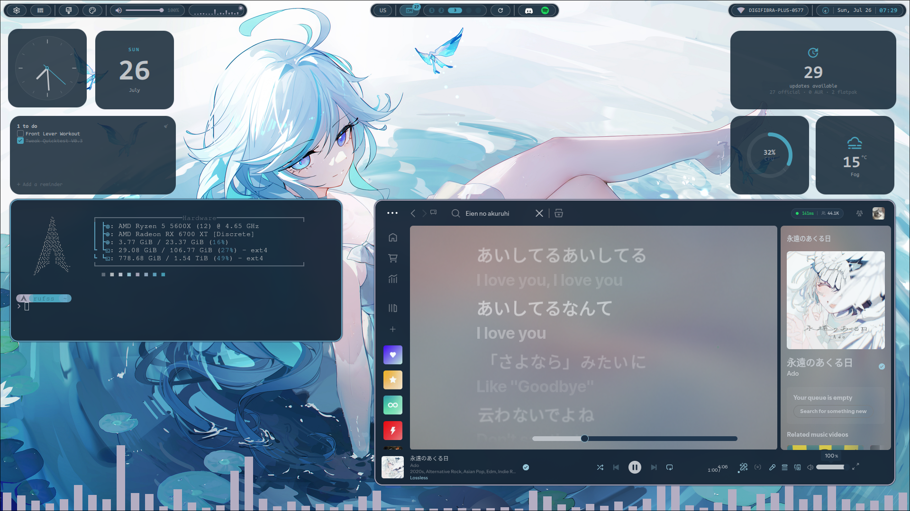
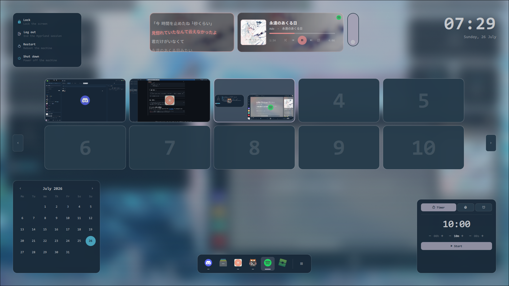
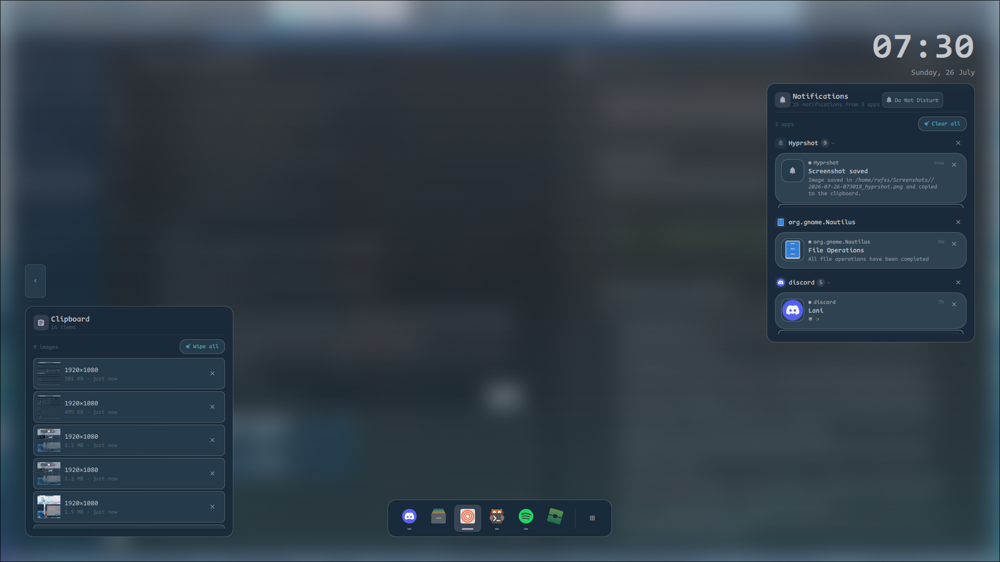
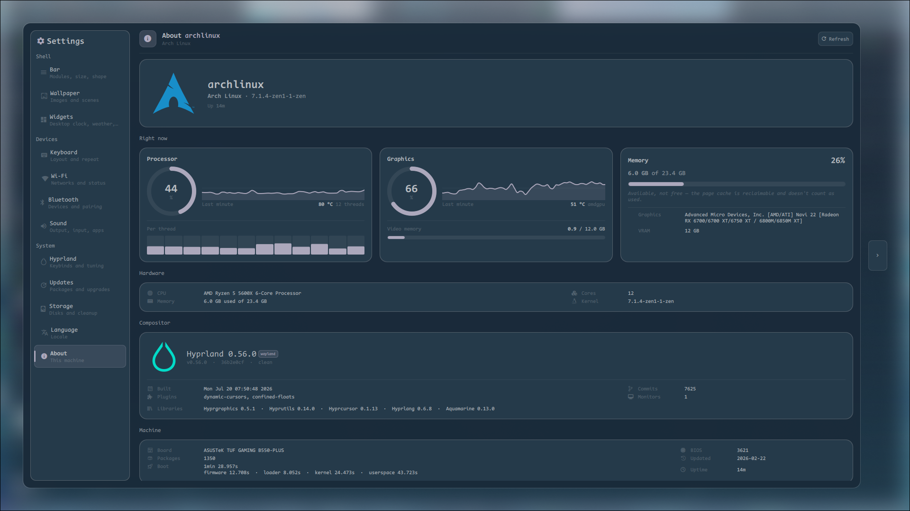

<div align="center">

# Quicktest — Quickshell Config

**A desktop shell for Hyprland, built on [Quickshell](https://quickshell.outfoxxed.me/).**

*A minimal look, backed by more machinery than that implies.*



`v0.3` · Arch Linux · Hyprland · QML/JS

</div>

---

## About this release

**v0.3 is a full-codebase refactor**, not an incremental update. The bar, the theming
pipeline, and the process model underneath all of it were rebuilt. Rough shape of what
changed:

- **One shared service layer.** Audio, brightness, network, cava, notifications, updates,
  and everything else used to be reimplemented per-widget — several pollers reading the
  same state, several `cava`/`wpctl`/`checkupdates` processes doing the same work in
  parallel. Every piece of system state now has exactly one singleton service that owns
  it; widgets bind to that, they don't spawn their own.
- **A real design system.** Colors, spacing, radii, and motion all come from shared
  `Colors` / `Tokens` / `Motion` singletons. No widget hardcodes a hex value or invents
  its own animation curve — see [Architecture](#architecture--for-contributors) below.
- **Event-driven, not polled**, wherever the underlying API allows it — Hyprland IPC
  events, D-Bus signals, file watches — and refcounted timers for the few things that
  do have to poll, so nothing runs when nobody's looking at it.
- **A much bigger feature set**: a full in-shell settings app, a Steam-overlay-style
  workspace overview, desktop widgets, a built-in notification daemon, a colour-scheme
  editor, and support for animated Wallpaper Engine scenes alongside static wallpapers.

The previous status-bar-only build is still visible in the repo history for the curious
(`v0.1`).

---

## Table of contents

- [Highlights](#highlights)
- [The bar](#the-bar)
- [Theming & wallpapers](#theming--wallpapers)
- [The overview](#the-overview)
- [Desktop widgets](#desktop-widgets)
- [Notifications](#notifications)
- [Settings](#settings)
- [Directory structure](#directory-structure)
- [Dependencies](#dependencies)
- [Installation](#installation)
- [Keybinds & IPC](#keybinds--ipc)
- [Architecture (for contributors)](#architecture--for-contributors)

---

## Highlights

- 🧱 **Fully customizable bar** — drag-and-drop module layout, floating pill or
  edge-to-edge shapes, unified or split-pill modes, saveable presets
- 🎨 **Live palette engine** — wallpaper-derived colours via pywal, per-swatch pinning,
  saved colour schemes, light/dark mode, all with zero reload
- 🖼️ **Two wallpaper engines** — static images through a full 10-step theming pipeline,
  or animated Wallpaper Engine (Steam Workshop) scenes
- 🪟 **Overview** — a Steam-overlay-style desktop view: workspace grid, dock, now
  playing with word-synced lyrics, calendar, clipboard history, timers, power menu
- 🧩 **Desktop widgets** — 17 draggable, snap-to-grid tiles (clock, weather, notes,
  system monitor, disk, network, and more) in a glass or flat style
- 🔔 **Built-in notification daemon** — replaces dunst/swaync outright, with a toast
  layer and a full history centre
- ⚙️ **In-shell control center** — bar, Wi-Fi, Bluetooth, sound, battery, storage,
  keyboard layouts, updates, and a native Hyprland config editor (binds + tuning),
  all without opening a text editor
- ⚡ **Performance-minded architecture** — one shared service per system resource, event
  driven instead of polled, lazy-loaded popups, refcounted background work

---

## The bar

Two independent shape/layout axes:

| | |
|---|---|
| **Shape** | Floating pills, or square corners flush to the screen edges |
| **Mode** | Unified — each region merges into one pill with internal dividers — or split, one pill per module group |

Everything about it is editable from **Settings → Bar**: thickness, corner roundness,
inset from the screen edge, spacing, opacity, font/icon scale, and whether it grows on
hover. Layout is drag-and-drop — drop a module onto another to group them, into a gap to
start a new group, or onto the pool to remove it. The whole thing is captured by
**presets**: save the current arrangement under a name, switch between saved presets, or
reset to the built-in default at any time.

**Modules available on the bar:**

| Module | What it does |
|---|---|
| Bar shape | Toggles floating pills ↔ square, edge-to-edge corners |
| Bar mode | Merges each region into one pill, separated by dividers |
| Colour scheme | Opens the palette panel — the wallpaper-derived scheme and its variants |
| Wallpaper | Opens the wallpaper picker; choosing one re-derives the whole palette |
| Volume | Scroll to change volume, click for the mixer, right-click for a slider |
| Keyboard layout | Shows the active XKB layout; click to cycle configured layouts |
| Updates | Pending package count; click to review and install |
| Workspaces | Five dots, paging in groups of five, the bar's visual anchor |
| Reload | Restarts the shell |
| System tray | Hides itself when nothing is running |
| Visualizer | Live audio spectrum; right-click for media controls, click for the desktop background version |
| Wi-Fi | Signal strength tinted by quality; click for networks, right-click for the connection name |
| Clock | The time; click to toggle a large desktop clock behind your windows |
| Notifications | Opens the notification centre; right-click toggles Do Not Disturb |
| Overview | Opens the overview |
| Settings | Opens the settings app |

---

## Theming & wallpapers

**Palette.** Colours come from pywal (or a wallust-compatible `colors.json`), watched
live — the whole shell repaints the instant a new palette is written, no reload needed.
The design system separates two accent roles deliberately: `primary` for things you can
act on, `focus` for what you're currently pointing at or have open, so hover and active
states never collapse into the same colour.

**Colour scheme editor.** Pin individual swatches, or save and apply whole schemes — six
are bundled (*Blue Haven*, *Candy Like*, *Crimson Beauty*, *Girly Vibes*, *Monochrome*,
*RuLe*). Overrides persist to disk and survive wallpaper changes until you release them;
light/dark mode re-derives the palette from the same wallpaper rather than needing a
second image.

**Static wallpapers.** Applying one from the gallery runs a full theming pass in order:
sets the wallpaper (`awww`, slide transition), regenerates the pywal palette, reloads the
notification daemon's styling, updates Spicetify, rewrites and hot-reloads kitty's colours,
pushes to Firefox via pywalfox, recolours Discord (Vencord/Vesktop), patches the cava
gradient, and copies the image for reference. Each step is optional per its own dependency
— the pipeline degrades gracefully if a target app isn't installed. A shuffle mode can
rotate wallpapers on an interval.

**Wallpaper Engine.** Animated Steam Workshop scenes via `linux-wallpaperengine`, with
its own settings pane — target monitor, FPS cap, V-Sync, mouse/parallax reactivity, audio
processing, mute/volume, pause-on-fullscreen, and (optionally) deriving the shell's
palette from the scene's preview image, same as a static wallpaper would.

A master **theming switch** lets you change wallpapers freely without touching the
palette at all, for anyone who'd rather hand-pick or lock a colour scheme.

---

## The overview

A full-screen, see-through overlay over your live desktop — opened by bar module or IPC
— holding everything you might reach for at a glance:



- **Workspace grid** — live window thumbnails, drag windows between workspaces
- **Now playing** — media controls with word-synced lyrics where the provider supports
  it, coloured from the current album art rather than the shell palette
- **Notifications, clipboard history, calendar, and timers/stopwatch** as their own cards
- **Dock** and a **power menu**

---

## Desktop widgets

A background-layer surface per screen holding draggable, snap-to-grid tiles: clock,
world clock, calendar, weather, countdown, timer, notes, reminders, disk, network,
system monitor, updates, now playing, audio visualizer, photo frame, clipboard, and sun
(sunrise/sunset). Each tile can be a graded "liquid glass" surface with a sheen and rim,
or a flat translucent one — a per-install preference, since glass reads as noise over a
very busy wallpaper.

---

## Notifications

A built-in daemon binds the `org.freedesktop.Notifications` D-Bus name directly — it
**replaces dunst or swaync**, not layers on top of them (only one can hold that name at a
time). Toasts render on the focused monitor; a full history centre keeps everything until
you clear it, with Do Not Disturb toggleable from the bar.



Clipboard history lives in the overview too — including image thumbnails, not just text.

---

## Settings

An in-shell control centre, reachable from the bar or the overview:



| Page | Covers |
|---|---|
| Bar | Layout editor, shape, presets, per-module settings |
| Wallpaper | Static gallery + theming pipeline, Wallpaper Engine |
| Widgets | Desktop widget placement and style |
| Network | Wi-Fi list, connect/forget, DNS |
| Bluetooth | Adapters, pairing, connected devices |
| Sound | Output/input devices, per-app mixer, mic test |
| Battery | Charge, health, power profile *(only shown if a battery exists)* |
| Storage | Disk usage breakdown |
| Updates | Pending packages, install with progress |
| Keyboard | XKB layouts |
| Language | System language |
| Hyprland | Keybinds and compositor tuning (appearance/blur, input, animations), read from and written straight to your native `~/.config/hypr` Lua config — with backups and syntax-checking on every write |
| About | Shell version, links back to this repo |

---

## Directory structure

```
quicktest/
├── shell.qml                # Entry point — mounts every surface per screen
├── config/                  # Design system + user preferences
│   ├── Config.qml           #   Persisted preferences (the settings app's backing store)
│   ├── Colors.qml           #   The one place that knows what a colour is
│   ├── Tokens.qml           #   Spacing, radii, type scale — the design system baseline
│   ├── Motion.qml           #   Shared durations/easing
│   └── settings/            #   Reference implementation used during the refactor
├── state/
│   └── UiState.qml          # Transient "what's on screen right now" — not persisted
├── services/                 # One singleton per system resource — audio, network,
│                              #   brightness, bluetooth (native), notifications, cava,
│                              #   clipboard, wallpapers, lyrics, updates, weather…
├── components/               # Shared UI primitives — Card, Toggle, ContextMenu,
│                              #   IconButton, Sparkline, RadialGauge, GlassOverlay…
├── modules/
│   ├── bar/                 # The status bar and its widgets
│   ├── panels/               # Popups the bar opens — wallpaper, colour scheme, wifi,
│                              #   equalizer, updates, tray menu, app launcher
│   ├── overview/             # The full-screen overview and its cards
│   ├── desktop/               # Screen frame, desktop clock, widget layer + widgets
│   ├── notifications/        # Toast + history centre surfaces
│   ├── net/                  # Shared Wi-Fi browser used by the panel and settings
│   └── settings/             # The in-shell control centre and its pages
├── colorschemes/             # Bundled colour schemes (JSON)
├── presets/                  # Bundled bar presets (JSON)
├── theming/                  # Palette override + pywal integration files
├── shaders/                  # Custom fragment shaders (liquid-glass effect)
├── assets/                   # Icons and logos
└── scripts/                  # Shell + Python helpers the QML layer shells out to
    ├── apply-wallpaper.sh     #   The static-wallpaper theming pipeline
    ├── reload-theme.sh
    ├── reload-quickshell.sh
    ├── hypr-config.py         #   Reads/writes the native Hyprland Lua config
    ├── lyrics.py               #   Word-synced lyrics, multi-provider
    ├── album-colors.py         #   Palette extraction from album art
    ├── clip-store.py           #   Clipboard history recorder
    ├── specs.sh / storage.sh
    ├── pacman-update.sh
    └── install-dependencies.sh
```

---

## Dependencies

| Tool | Purpose |
|---|---|
| `quickshell` | Shell framework |
| `hyprland` | Window manager — workspace/window data over IPC |
| `qt6-base`, `qt6-declarative`, `qt6-wayland`, `qt6-svg`, `qt6-5compat` | Qt runtime Quickshell needs |
| `pipewire`, `pipewire-pulse`, `wireplumber` | Audio — volume, mixer, per-app streams |
| `networkmanager` | Wi-Fi list, connect, DNS |
| `bluez` | Bluetooth adapters and devices |
| `upower`, `power-profiles-daemon` | Battery status and power profile |
| `brightnessctl` | Internal-panel brightness (fallback) |
| `ddcutil` | External-monitor brightness over DDC/CI *(optional)* |
| `cava` | Audio spectrum — falls back to a demo animation if absent |
| `wl-clipboard` | Clipboard history capture/write |
| `inotify-tools` | Watches `colors.json` for palette changes |
| `python` (stdlib only) | Runs the helper scripts — no extra `pip` packages needed |
| `pacman-contrib` | `checkupdates`, for the update count/panel |
| `flatpak` | Flatpak update support |
| `pywal16` (`python-pywal16` on the AUR) | Palette generation from a wallpaper |
| `awww` | Wallpaper setter with smooth transitions |
| CodeNewRoman Nerd Font | Bar/UI font |

**Optional, third-party integrations** (not installed by the script below — enable
whichever you actually use):

| Tool | Used for |
|---|---|
| `linux-wallpaperengine` | Animated Steam Workshop wallpapers |
| `spicetify` | Spotify theme repainting |
| `pywalfox` | Firefox palette theming |
| Vencord / Vesktop | Discord palette theming |
| Zen Browser | Additional browser theming |
| GTK4 apps | GTK4 CSS generation (`scripts/generate-gtk4-css`) |
| `kitty` | Live theme reload via `SIGUSR1` |

---

## Installation

```bash
# Clone or copy into the Quickshell config directory
git clone https://github.com/rufss14/Quickshell-Config.git ~/.config/quicktest

# Install the required system dependencies (Arch/AUR, via yay)
~/.config/quicktest/scripts/install-dependencies.sh

# Launch
quickshell -p ~/.config/quicktest/shell.qml
```

Or use the included reload script during setup:

```bash
~/.config/quicktest/scripts/reload-quickshell.sh
```

Drop wallpapers into `~/wallpapers/walls/` for the gallery to pick them up, and check
`config/Config.qml` if you want to see every available preference — it's heavily
commented and doubles as the settings app's own documentation.

---

## Keybinds & IPC

The launcher and overview each own their own window and are reachable by IPC, so they
can be bound to a Hyprland keybind directly:

```bash
qs ipc -c ~/.config/quicktest call launcher toggle
qs ipc -c ~/.config/quicktest call overview toggle
```

---

## Architecture (for contributors)

A few rules the codebase holds itself to, worth knowing before sending a PR:

- **Colours only from `Colors`.** Never a hardcoded hex. Spacing, radii, type scale, and
  motion durations/easing come from `Tokens`/`Motion` — widgets consume them, they don't
  invent their own.
- **One service per system resource.** Audio, network, brightness, cava, and so on are
  each a singleton owned in `services/`. A widget binds to the singleton; it never opens
  its own subprocess or poller to get the same data another widget already has.
- **Event-driven over polling**, wherever the API allows it. Where polling is genuinely
  the only option, the timer is refcounted — it runs only while something is actually
  displaying the value, and stops the moment nothing is.
- **Presentation / logic / system integration stay separate.** QML for presentation, JS
  for logic, and IPC/D-Bus/subprocess calls live in `services/` or `scripts/`, never
  inlined into a widget.
- **`Config` vs `state/UiState`.** `Config` is durable — what the user has set up, written
  to disk. `UiState` is transient — what the shell is showing *right now* (which panel is
  open) — and deliberately isn't restored across a reload.
- **Lazy-load anything not always visible.** Popups and overlays load on demand rather
  than sitting mounted-but-hidden.
