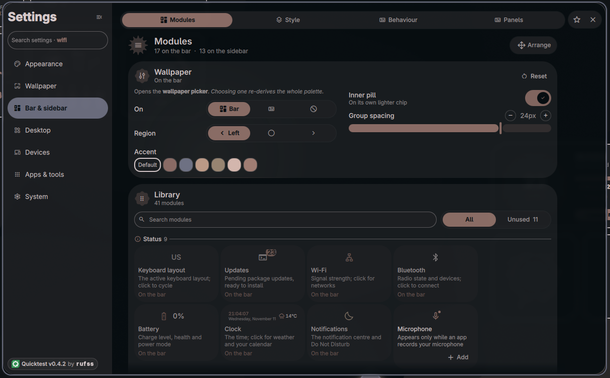
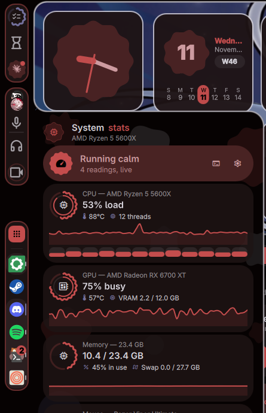

<div align="center">

# Quicktest

### A Quickshell desktop shell for Hyprland


`v0.4.1` &nbsp;|&nbsp; Arch Linux &nbsp;|&nbsp; Hyprland &nbsp;|&nbsp; QML / JS

</div>

Quicktest is a desktop shell built on [Quickshell](https://quickshell.outfoxxed.me/): a bar
and a sidebar, plus a launcher, a workspace overview, a notification daemon, a lock screen,
a clip recorder, a settings app, and a theming pipeline that repaints your apps along with
the shell. Everything draws from one wallpaper-derived palette and one set of design tokens.

**You need** Arch Linux, Hyprland 0.56 or newer (it uses the Lua config), and a GPU with a
Vulkan driver. Quickshell and everything else come from setup.

## Quick start

```sh
curl -fLO https://github.com/rufss14/Quickshell-Config/releases/latest/download/quicktest.tar.xz
tar -xJf quicktest.tar.xz -C ~/.config          # → ~/.config/quicktest
cd ~/.config/quicktest && ./setup.sh             # packages, then three yes/no questions
```

Log out and back in, and the shell starts with Hyprland. More options under
[Installation](#installation).

**Jump to:** [Features](#features) · [Installation](#installation) · [Updating](#updating) ·
[Keybinds](#keybinds) · [Configuration](#configuration) · [Dependencies](#dependencies) ·
[Troubleshooting](#troubleshooting) · [Contributing](#contributing)

## What's new in 0.4.1

- **One Modules page for the bar and the sidebar.** A module library shows every module by
  kind, where it is now, and why one is unavailable. Any module can live on either edge,
  looks the same on both, and you drag it across. Arranging dims the desktop and shows
  exactly where a drop will land.
- **Rebuilt panels.** Screen time, Brightness, Wi‑Fi, Bluetooth, Clipboard, To‑do, Timer,
  Stats and Claude sessions share one look: a card that says what's going on, and tiles below.
- **Tooltips on the bar**, and a hover on a workspace shows its windows as live tiles.
- **Clips** gains a latest-clips row, tags, filters, hover scrub, a clean-up button, and
  Send to Discord that shrinks a clip to your upload limit.
- **Discord call log**, **VPN switching** in the Wi‑Fi panel, **high contrast** and
  **reduced motion** settings, and **export/import of your whole look**.
- **Steam follows the palette live** and starts in about 9 seconds instead of 80.
- **Safer by default:** crash-looping startup falls back to safe mode, and the Spotify bridge
  no longer accepts requests from websites.

Full notes are on the [releases page](https://github.com/rufss14/Quickshell-Config/releases).
Coming from v0.3 or older, install by hand once: see [Updating](#updating).

## Features

### The bar


Floating pills or square edge-to-edge, one pill per region or one per group. Thickness,
radius, opacity, font and icon scale are in **Settings → Bar & sidebar**. Arrange it by
dragging modules between groups, between the bar and the sidebar, or back into the library;
save layouts as presets.



Modules: workspaces, visualizer and Now Playing with synced lyrics, clock and weather, volume
and microphone, Wi‑Fi, Bluetooth, battery, wallpaper and colour scheme, updates,
notifications, night light, stay awake, game mode, keyboard layout, system tray, the dock,
and shortcuts to the overview, settings and reload.

### Panels

Every panel opens from the bar, welds into its frame as one shape, and sizes itself to its
content. Panels open beside each other and morph from one to the next. The optional blob
plugin fuses panel and bar with a metaball shader.

<table>
<tr>
<td width="50%"></td>
<td width="50%"></td>
</tr>
<tr>
<td align="center"><sub>Wallpaper gallery: images and Wallpaper Engine scenes together</sub></td>
<td align="center"><sub>Colour scheme: edit any slot, save palettes, follow the album</sub></td>
</tr>
</table>

Also: Wi‑Fi (with VPNs), Bluetooth (pairing, battery, file sending), audio mixer and
equalizer, updates, notifications, clipboard, timer, to‑do, system stats, and more.

### The sidebar and dock

<table>
<tr>
<td valign="middle">

The second edge, arranged like the bar. It can auto-hide and dodge windows.

- **Dock:** pinned apps, then running ones. Click to focus or cycle, middle-click to close,
  right-click for the jump list, drag to reorder, hover for live previews. It can sit on the
  bar instead.
- **Small modules:** stats, clips, timer, colour picker, clipboard, notifications, screen
  time, Lens, Claude Code sessions, the Discord call panel, and power.

SUPER+D reveals it while hidden; SUPER+SHIFT+D hides or shows it entirely.

</td>
<td width="40%"></td>
</tr>
</table>

### The launcher

SUPER+R. Type to search apps, ranked by how you launch them. Prefixes switch modes:

| Type | To |
|------|----|
| `>` command | Run it in your terminal |
| `?` question | Ask an AI provider (bring your own key), or search the web |
| `12*8` · `10 km to mi` | Calculate · convert units |
| `+` name | Install a package from the repos or the AUR, with live progress |

### The overview


SUPER+TAB. Every workspace as a live grid of window thumbnails. Drag windows between
workspaces, type to find one, or press 1–0 to jump. **Alt+Tab** works inside the same grid.
Volume, brightness and power controls sit around it.

### Theming and wallpapers

- **One palette** of sixteen colours from the wallpaper (pywal), light or dark, applied live.
  Pin colours, save schemes, or pick a bundled one.
- **Follow the album cover** while music plays, optionally locked until it stops.
- **Every app repaints:** kitty, GTK and Qt, Discord (Vencord/Vesktop), Spotify (Spicetify),
  Steam (Millennium), Zen/Firefox (Pywalfox), Dark Reader, Hyprland borders and the cursor.
  A target is skipped if its app isn't installed.
- **The wave:** a new wallpaper or colour sweeps up the screen as one front.
- **Wallpapers:** images from a folder, or animated Steam Workshop scenes through
  `linux-wallpaperengine`. Shuffle on a timer; give each workspace its own wallpaper and
  palette.

### Clips


A replay buffer and recorder on `gpu-screen-recorder`, off until you enable it.
**ALT+F10** saves the last stretch, **ALT+F9** records the screen, **ALT+SHIFT+F9** a region.
The editor trims, then exports video or GIF (lossless or precise, to 10/25/50 MB) or a single
frame. The library has favourites, tags, filters and search.

### Everyday tools

| Tool | |
|------|---|
| **Lens** | SUPER+O: select an area and copy its text (OCR). SUPER+SHIFT+O translates it in place |
| **Screenshots** | A toast with a preview: copy, annotate, send over Bluetooth, or trash |
| **Magnifier** | SUPER+CTRL+scroll to zoom, SUPER+CTRL+Z to toggle |
| **Snap zones** | SUPER-drag a floating window to an edge, corner or the top |
| **Game mode** | SUPER+G: performance CPU, notifications paused, no screen blanking |
| **Night light · Anti-flashbang** | Warm the screen; dim a sudden full-white one |
| **Notifications** | A built-in daemon (replaces dunst/swaync) with history and Do Not Disturb |
| **Lock screen** | The shell's own, locking before suspend; optional matching greetd login screen |
| **Sound effects** | Optional synthesised UI sounds and keyboard clicks |

### Integrations

- **Discord:** a call panel (who's talking, per-person volume and pan, mute/deafen, a call
  log), plus rich presence for Claude Code and Counter-Strike 2. Works with Vesktop, WebCord,
  Legcord, ArmCord, Dorion, Canary and PTB.
- **Spotify:** word-by-word lyrics through a bundled Spicetify bridge, with NetEase and
  LRCLIB as fallbacks and optional translation.
- **Claude Code:** recent sessions to resume, and your rate-limit usage.
- **Steam:** repaints with the palette through Millennium.

### Settings


A searchable settings app in ten groups: Appearance, Wallpaper, Bar & sidebar, Launcher,
Sidebar, Desktop, Devices (sound, displays, Wi‑Fi, Bluetooth, input, battery), Window manager
(keybinds and compositor tuning, written to your Hyprland config with backups), Integrations,
and System (updates, setup, presets, storage, about).

## Installation

Arch Linux with Hyprland. The setup script picks the right Vulkan driver for your GPU.

**1. Get the shell.** From a release, for automatic updates:

```sh
curl -fLO https://github.com/rufss14/Quickshell-Config/releases/latest/download/quicktest.tar.xz
tar -xJf quicktest.tar.xz -C ~/.config      # → ~/.config/quicktest
```

Each release also has a `quicktest.zip` of the same files; the updater works with either.
Or clone it, and update with `git pull` instead of the built-in updater:

```sh
git clone https://github.com/rufss14/Quickshell-Config.git ~/.config/quicktest
```

**2. Run setup.**

```sh
cd ~/.config/quicktest && ./setup.sh
```

It installs the packages, then asks one yes/no each about the blob plugin, the bundled
Hyprland config (yours is backed up first) and the autostart line. `./setup.sh --packages`
does only the packages. Skipping anything is safe: the same steps are in the welcome panel
and **Settings → Setup** on first start.

**3. Launch.** Log out and back in, or start it by hand:

```sh
bash -c 'source scripts/shell-env.sh && exec qs -p "$PWD"'
```

Keeping your own Hyprland config? Add the [keybinds](#keybinds) you want to it. With the
bundled one, set your monitors in `~/.config/hypr/hardware.lua`.

<details>
<summary>Step by step instead of <code>setup.sh</code></summary>

```sh
scripts/install-dependencies.sh            # packages, the font, the Vulkan driver, feature packs
scripts/install-hypr-config.sh             # the bundled Hyprland config (--print to preview)
scripts/install-autostart.sh               # or just the autostart line for your own config
scripts/build-blobs-plugin.sh              # optional: the blob plugin
```

`install-dependencies.sh --official` / `--aur` / `--packs` print package lists without
installing; `--pack ddc|beatsync|discordkeys` adds an optional pack.

</details>

## Updating

The shell checks for a release every 6 hours, or when you press the gear in the update panel.
Click the update pill to install: no password, and the shell restarts on the new version.

Releases are signed, and your install only accepts updates signed with the key it already
has. Updates keep your settings, presets, colour schemes and API keys. Shell files you
edited by hand **are** replaced, so keep tweaks in a shell preset (**Settings → Shell preset**).

Coming from v0.3 or older, or installed with `git clone`: install this version once by hand.
A git checkout updates with `git pull`.

## Keybinds

In the bundled Hyprland config. On your own, bind any of them to the same `qs ipc` call.

| Keys | Action |
|------|--------|
| SUPER+R | Launcher |
| SUPER+TAB · ALT+TAB | Overview · switch windows inside it |
| SUPER+D · SUPER+SHIFT+D | Reveal the sidebar · hide/show it entirely |
| SUPER+T · SUPER+ALT+1…9 | Focus the dock · launch or focus the nth dock app |
| SUPER+O · SUPER+SHIFT+O | Lens: copy text · translate |
| SUPER+G | Game mode |
| SUPER+CTRL+scroll · SUPER+CTRL+Z | Magnifier |
| ALT+F10 · ALT+SHIFT+F10 | Save a clip · toggle clipping |
| ALT+F9 · ALT+SHIFT+F9 | Record the screen · record a region |
| ALT+Q | Restart the shell |
| SUPER+L | Lock (falls back to hyprlock if the shell doesn't answer) |

```sh
qs ipc -c ~/.config/quicktest call launcher toggle
qs ipc -c ~/.config/quicktest show              # every target the shell exposes
```

## Configuration

- **Settings** live in `$XDG_STATE_HOME/quickshell/by-shell/<id>/config.json`, outside the
  shell folder, so updates never touch them. Everything is editable in **Settings**.
- **Presets** are named snapshots kept in `presets/`: whole-shell (`shell.json`), bar layouts,
  cursor looks and desktop widget placement. Carry one to another machine and Apply.
- **Secrets** (Discord app, AI keys, DeepL key) are written `0600` to
  `$XDG_STATE_HOME/quicktest/secrets/`, outside the shell folder, and never leave your machine.
- **Wallpapers** are read from `~/wallpapers/walls` unless you pick another folder in
  **Settings → Wallpaper**.

## Dependencies

`./setup.sh` installs the core and the default feature packs. The main ones:

| Package | For |
|---------|-----|
| `quickshell`, `hyprland`, `qt6-*` | The shell, the compositor, the Qt runtime |
| `pipewire`, `wireplumber`, `networkmanager`, `bluez` | Audio, network, Bluetooth |
| `python-pywal16`, `python-pillow`, `imagemagick` | Palettes from wallpapers and album art, the cursor theme |
| `cava` | The audio visualizer |
| `gpu-screen-recorder`, `ffmpeg`, `slurp` | Clips (default pack) |
| `gamemode`, `mangohud` | Game mode (default pack) |
| `hyprsunset`, `hyprpicker`, `wl-clipboard` | Night light, colour picker, clipboard history |
| `pacman-contrib`, `openssh`, `xz`, `curl` | Update checks, and verifying and downloading shell updates |

Unticked packs in **Settings → Setup**: `ddcutil` (external-monitor brightness), `python-numpy`
(wallpaper effects on the beat), `xdotool` + `wtype` (Discord's share/camera buttons).
Offered one at a time: `linux-wallpaperengine`, `spicetify-cli`, `python-pywalfox`,
`python-argostranslate`, `tesseract` (Lens), `greetd`. A feature that needs a missing tool
disables itself and says which one; it never fails on click.

## Troubleshooting

- **Something is missing or greyed out.** **Settings → Setup → Health check** lists what isn't
  installed and installs it.
- **The shell misbehaves.** ALT+Q restarts it. Log: `qs log -p ~/.config/quicktest` (`-f`
  to follow). If it crashes while starting, it retries, then starts in safe mode.
- **A setting won't stick, or the bar looks wrong after an update.** Move the settings file
  (see [Configuration](#configuration)) aside and restart for the defaults.
- **Include diagnostics in bug reports:** **Settings → About → Copy diagnostics**. Your home
  folder, user name and computer name are removed.

**Uninstalling:**

```sh
~/.config/quicktest/scripts/install-autostart.sh --uninstall   # remove the autostart line
rm -rf ~/.config/quicktest
```

If you installed the bundled Hyprland config, your old one is at
`~/.config/hypr.bak.<timestamp>`; move it back to `~/.config/hypr`. Settings and secrets stay
under `$XDG_STATE_HOME` (usually `~/.local/state`) until you delete them.

## Contributing

[CONTRIBUTING.md](CONTRIBUTING.md) covers checking a change and adding a setting, service,
page or dependency; `docs/` has notes for each area. The rules the codebase holds:

- **Colours only from `Colors`**, everything else from `Tokens` and `Motion`. No hardcoded hex,
  spacing, radius or duration.
- **One service per system resource.** Widgets bind to it; they never open their own
  subprocess or poller.
- **Presentation, logic and system integration stay separate.** Algorithms live in a testable
  `.js` beside the service; IPC, D-Bus and subprocesses live in `services/` and `scripts/`.
- **Event driven over polling; lazy load what isn't always visible.**
- **A missing optional tool disables its control with a reason.**

`bash scripts/check-all.sh` runs every static checker and test (a pass means "no typos", not
"it works"); `bash scripts/smoke-headless.sh` starts a throwaway shell in a sandbox and opens
every panel. CI runs both. Tested on Quickshell 0.3, Hyprland 0.56 and Qt 6.11–6.12.

```
quicktest/
├── shell.qml        Entry point
├── config/          Colors, Tokens, Motion, and Config (the settings store)
├── state/           What's on screen right now, not persisted
├── services/        One singleton per system resource
├── components/      Shared UI
├── modules/         bar, panels, overview, desktop, notifications, lock, settings, dock…
├── hypr/            The bundled Hyprland config (Lua)
├── plugin/          The optional blob plugin (C++)
├── scripts/         Helpers, installers, checks and tests
├── docs/            Per-feature notes: how each part works and why
└── assets/          Icons, fonts, logos, previews
```

The UI is English-only for now; `docs/translations.md` has the tooling to add a language.

## License

See [LICENSE](LICENSE). Third-party logos in `assets/logos/` belong to their projects; see
the README there.
